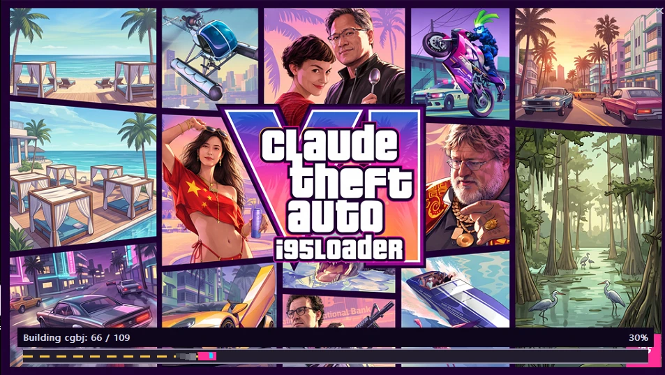

# i95: GTA 6 PC Launcher for every GTA VI Xbox Series runtime (VIctory, Kelvaroq, VItoriaBr and more)

Try them all from one window.

i95 is a Windows launcher for the projects trying to run the Xbox Series version of GTA VI on PC. It doesn't include or download the game, and there are no game files, keys or protection bypasses in it.

**It builds every runtime from source on your PC.** Each runtime's source code is pinned to one commit you can read on GitHub, and i95 compiles it locally with Rust, so you never run an .exe someone else built. That's safer than downloading prebuilt runtime exes, which is how fake "GTA 6 PC" malware spreads.

## What it does

- **One list of runtimes**, ranked like the race tracker, each with its author's own default launch settings.
- **Stays current without an update**: at start it reads the runtime list from [catalog.txt](catalog.txt) here. Every hour each runtime is moved to its author's newest commit (scripts/bump-upstreams.sh, run by hand, no bot), and any commit that changes the author's launch settings is checked by hand before it goes in. Every launcher picks up the list on its next start. No new release is needed. Offline it uses the list it shipped with.
- **Builds and rebuilds** a runtime only when its source changed, and keeps each runtime's shader cache when it does (a fork that keyed its cache on its own exe, KLBF Lab, is patched to key on its shader translator instead; `NEONBRIDGE_SHADER_KEY_PATCH=0` turns that off).
- **Prepares shaders** before the game starts, with a loading screen that shows real progress.
- **Checks your PC first**: graphics card features (D3D12, Shader Model 6.6, mesh shaders), RAM and free disk, and names what's missing.
- **Presets** per runtime, such as Series S, 8 GB cards, 16 GB of RAM (Vice-Tay's `4060` preset: ~16 fps on an RTX 4060 here) and crash diagnostics, plus any extra setting a runtime reads.
- **In game**: an fps and frame-time overlay, a controls overlay, and the display kept awake.
- **After a run**: explains why it ended by reading the log, writes a short timeline, and can file an issue report.
- **Asks before downloading** a runtime's source or an optional extra. The one thing it fetches without asking is the small runtime list, catalog.txt.

**None of these runtimes is confirmed playable yet.** The tracker's bar for playable is 20 fps and 30 minutes without a crash. Only Vice-Tay reports clearing it (a 30-minute session at a 21.1 fps median on an RTX 4090), and nobody outside the project has checked it.

## Standings

Ranks come from vuyp's [GTA VI PC race tracker](https://vuyp.github.io/gta6-pc-race/) ([repo](https://github.com/vuyp/gta6-pc-race)). i95 has 31 runtimes, and the launcher lists them in one list in that order.

"Its author reports" is what each project says about itself, in its own words where we could. "Here" is our own PC: i5-14400F, RTX 4060 8 GB, 16 GB RAM, Windows 11. Most authors test on faster cards, so expect less on yours if it's like ours.

| Rank | Runtime | Based on | Its author reports | Here |
|---:|---|---|---|---|
| 1 | [Vice-Tay](https://github.com/TaynanGT/Vice-Tay) | VIctory | The tracker's leader and playable by its own report: a 21.1 fps median over a 30-minute session played by hand, Series S profile, RTX 4090 | ✅ The 4060 preset: 3D at ~16 fps in the first room at 1080p on an RTX 4060 8 GB with 16 GB of RAM, but the picture looks rough (Series S plus low budgets). Plain Series S got 3 to 4 fps, because it used 17 GB of RAM and paged to disk; 8gb got 5 fps. Series X (its default) runs out of graphics memory on an 8 GB card in the first cutscene and crashes; use series_s or 8gb |
| 2 | [victory-fork](https://github.com/fxceless/victory-fork) | VIctory | 9.7 fps at the first boat mission, 10 to 14 in light scenes, RTX 4070; the graphics card is the limit | ✅ Intro at 30 fps, 3D scene ~1 fps |
| 3 | [AnyXboxX](https://github.com/LooperSalty/AnyXboxX) | Vice-Tay (was Neptune) | "About 24 fps median in the world in Full HD", 30 (the game's cap) in lighter scenes, Series X, RTX 4070 SUPER | ⚠️ On its new Vice-Tay base: reaches 3D at 0.5 to 3 fps in two 2 to 3 min runs, no crash; RAM full (15.5 of 15.8 GB), so it pages. Its earlier Neptune build ran 10 min at ~14 fps |
| 4 | [KLBF Lab](https://github.com/PastiiJay/klbf-lab) | VIctory, victory-fork | "Player in control" through the prologue, ~5.7 to 7.3 fps, 77 min session, RX 9070 XT | Testing again. Its intro crash was i95 leaving TuxBox DLLs in the game folder (fixed). The intro video flickers |
| 5 | [VIctory-Belobug-AMD](https://github.com/Belobug/VIctory-Belobug-AMD) | VIctory | ~22 fps with ray tracing off on an RX 7900 XTX | ❌ |
| 7 | [VItoriaBr](https://github.com/uiliannn/VItoriaBr) | VIctory, victory-fork | 4 to 6 fps on its main preset, 22 fps in an experimental build not yet merged, RTX 5060 Ti at 1080p | ✅ 3D prison scene at 2 to 3 fps |
| 9 | [ScarlettPort](https://github.com/ZigZagBoi1/ScarlettPort) | victory-fork | ~3 fps with the full picture on an RTX 3060 (Series S); a user reports 7 to 8 fps on an RTX 5070 | ✅ 3D at 2 to 3 fps |
| 12 | CGBJ ([cool_fox](https://github.com/DoubleGhosty/cool_fox), a continuation) | VIctory | 25 fps average in gameplay on an NVIDIA card, relayed by PortWatch and unconfirmed; an outside build reports a 22.4 fps median on the boat, also unverified; zero-copy buffers now on by default; the original repo is no longer on GitHub | Not run yet |
| 13 | [victory-amd](https://github.com/myokex/victory-amd) | victory-fork | 2 to 4 fps in the world, RTX 4070 | Not run yet |
| 14 | [VIctory](https://github.com/Marvisak/VIctory) | (the original) | The opening mission at about 1 fps on an RX 6700 XT, "not playable" | Not run yet |
| 15 | [Flamingo](https://github.com/realblastex/flamingo) | victory-fork | Tuned on "an NVIDIA RTX 4070". 9 to 12 fps in the first scene, a 24 min session | ⚠️ Runs at ~20 fps on average, but models are very dark and the screen flashes black and white |
| 16 | [BRVIctory-ka1qux](https://github.com/ka1qux/BRVIctory-ka1qux) | victory-fork | 10.5 fps on Series X with ray tracing off, 6.7 with it on, 15 fps on Series S, RX 7800 XT | Not run yet |
| 17 | [DexNom RayTime](https://github.com/DexNom/VIctory) | VIctory | Its "most complete tested build": ~1.1 to 1.3 fps in the city with ray tracing on, RX 7900 XTX | Not run yet |
| 18 | [Vilocity](https://github.com/voidopcode/vilocity) | cool_fox (was its own layer) | 26–27 fps at 5,000 draws a frame, 17–19 at 10,000–11,000, Series S, RTX 5080 | Not run yet |
| 19 | [CBL VIctory](https://github.com/cocainebunnylaboratories/cblvictoryvi) | VIctory, victory-fork | A 65 min session: 11.4 fps on the boat, 4.3 to 4.7 in the city, RTX 5080 | Not run yet |
| 21 | [Kelvaroq](https://github.com/stellarr-studio/kelvaroq) | VIctory, victory-fork | ~10 fps in typical views on an RTX 5080; a tester's 36 min session without a crash; shaders now translated once (heavy frames ~18 s to ~60 ms) | Testing |
| 22 | [victory-unified](https://github.com/Itsbatt/victory-unified) | VIctory | "A unified fork" of several, tuned for an RTX 3070 8 GB; ~22 fps on its RX 7900 XTX dev machine | Not run yet |
| 23 | [VIniVIdiVIci](https://github.com/KomanderDG88/VIniVIdiVIci) | victory-fork | 6.6 fps median in a 280 s scripted first-room run, RTX 4060 Ti | Not run yet |
| 24 | [VI-BR-PORT](https://github.com/edsuuu/VI-BR-PORT) | victory-fork | ~5.6 fps on Series X at 1080p and ~14 fps on Series S in the prison, RTX 4060 Ti 8 GB; the opening cutscene at ~18–19 fps; "Ainda não está jogável" (not playable yet) | ❌ The game stops about 20 s in |
| 25 | [ruff-lab](https://github.com/LoverCatys/ruff-lab) | KLBF Lab | Built for 8 GB cards and 16 GB RAM. 6 to 10 fps in the world (6.1 in heavy prison scenes), RX 6600 XT | Not run yet |
| 26 | [darkworldhm](https://github.com/darkworldhm/victory-fork-darkworldhm) | victory-fork | A snapshot of victory-fork with its own changes: 2 to 4 fps in the world, RTX 4070 | Not run yet |
| 27 | [VIctory-7900XTX](https://github.com/avatarmanz/VIctory-7900XTX) | VIctory | Series X at 1440p: 20 fps with ray tracing off, 10 fps with it on, RX 7900 XTX | ⚠️ Past the intro at ~15 fps, then out of graphics memory |
| 28 | [Vertex](https://github.com/proneonn/Vertex) | VIctory | "Not playable yet." 6.4 to 9.9 fps median by run, longest run 25 min, RTX 5070 | Not run yet |
| 29 | [VIctory-NVIDIA](https://github.com/trustno1-coder/VIctory-NVIDIA) | VIctory-7900XTX | 20 to 22 fps indoors on an RTX 5070, at half render scale on the Series S profile; no session length given | Not run yet |
| 30 | [Victory-United](https://github.com/Fayberr/Victory-United) | VIctory | VIctory's best open pull requests, rebuilt on Vice-Tay's code; ~11 fps in the first room over 7 and 10 min runs, RTX 3080 Ti | Not run yet |
| 31 | [VIctory-RDNA](https://github.com/XaviFortes/VIctory-RDNA) | VIctory | 23.1 fps median in gameplay at Series X 4K on an RX 7900 XT; about 40 minutes played by hand | Not run yet |
| 32 | [Scarlett fork](https://github.com/op-lite/victory-scarlett) | CGBJ | cool_fox plus a local fork's work: 16 to 21 fps in hand-played heavy scenes (prison yard, open world), Series X at 1440p, ray tracing off, RTX 4080 SUPER | Not run yet |
| – | [Kitty6](https://github.com/kitty-core/Kitty6) | VIctory-7900XTX | 20.5 fps median in the opening scene (Series S) on an RTX 4070, ~5 min runs; not on the tracker | Not run yet |
| – | [VKarameloVI](https://github.com/badDevelopper/VKarameloVI) | VIctory-NVIDIA | 11 fps, or 21.8 with NVIDIA Smooth Motion (frame doubling), on its author's card; not on the tracker | Not run yet |
| – | [cool-fox-12gb](https://github.com/miaohaixiang1-netizen/cool-fox-12gb) | CGBJ | cool_fox with VIctory-NVIDIA's 8 GB patches; 7.7 fps at half render scale, 2–3 fps native; not on the tracker | Not run yet |
| – | i95-Victory (ours) | Kelvaroq | Our own fork: Kelvaroq plus the 8 GB and skin fixes from VI-BR-PORT, soldsawn and VItoriaBr | Not run yet |

**Watching (not in i95 yet):** early projects from [PortWatch](https://portwatch-vi.xyz/) that don't reach the game's world on Windows; summaries are PortWatch's, unverified.

| # | Project | What it is | Here |
|---|---|---|---|
| – | [xbox-emulator](https://github.com/omonkeyz/xbox-emulator) | Rust runtime that runs dumped Xbox Series builds as normal Windows processes, continuing the TomBox project | Watch only |
| – | [xcl](https://github.com/xcl-dev/xcl) | Wine-style layer running game code natively | Watch only |
| – | [ScarlettX](https://github.com/Freminet/ScarlettX) | Clean-room high-level emulator of the Scarlett OS and GDK runtime | Watch only |
| – | [TuxBox](https://github.com/brcly/TuxBox) | Native-first layer for unpacked Xbox Series games, tested mostly on Linux through Proton | Watch only |
| – | [OpenScarlett](https://github.com/californiaAlmonds/OpenScarlett) | MIT-licensed C++20 translation layer targeting D3D12 and Vulkan | Watch only |
| – | [scarlett-layer](https://github.com/jadeowaowa/scarlett-layer) | Loader plus injected hook DLL that redirects console-only calls to Windows shims, with its own d3d12_xs wrapper and shader lifter | Watch only |
| – | [Xbox2Windows](https://github.com/R0Y00/Xbox2Windows) | Static recompilation research turning Xbox Series code and shaders into Windows C++ and DXIL, with over 50 contributors | Watch only |
| – | [keylime](https://github.com/ethan00013/keylime) | A C++20 runtime written from scratch, with Vulkan graphics and its own RDNA2-to-SPIR-V translator | Watch only |
| – | [xvalkyrie](https://github.com/sammwyy/xvalkyrie) | Wine-style C++ layer for Xbox One and Series titles with native code and RDNA2-to-HLSL shaders | Watch only |
| – | [GTAVI-Recomp](https://github.com/JamesCicada/GTAVI-Recomp) | Targets the PS5 build through AnyPS5 and will not work from leaked files, so game research is blocked | Watch only |
| – | [anyxboxseries](https://github.com/edupode/anyxboxseries) | GTA VI-only translation layer with a PE mapper borrowed from Xbox2Windows, an early scalar shader lifter and a sample game that tests presentation and input | Watch only |
| – | [SCARAB](https://github.com/p-portela/SCARAB) | Found that the console d3d12_xs uses the same 28 interface IDs as PC D3D12, so standard calls can be forwarded and only the console extensions need building | Watch only |
| – | [AnyBox](https://github.com/Dark3581/AnyBox) | Relinks GDK executables against reimplemented system libraries, AnyPS5-style | Watch only |
| – | [PercyScarlett](https://github.com/rpatty-dev/PercyScarlett) | Rust layer with stand-in system DLLs and an early shader recompiler | Watch only |
| – | [GrandTheftXbox](https://github.com/zohaiblazuli/GrandTheftXbox) | Wine-style layer planned for Series and One titles | Watch only |
| – | [NativeX-Runtime](https://github.com/ProhorovIlja/NativeX-Runtime) | Clean-room test programs for how Game Core software meets Windows, covering loading, memory, presentation and input, plus a radar that watches other projects | Watch only |
| – | [DedSec](https://github.com/Hylanderry/DedSec) | Portuguese-language GTA VI port targeting DirectX 12 with an RDNA2-to-HLSL translator | Watch only |
| – | [Xbgtasix](https://github.com/ljm-233/Xbgtasix) | Chinese-language layer that places stand-in xgameruntime, xmem and d3d12_xs DLLs next to an executable, plus sourced research notes on the archive, shader and texture formats | Watch only |
| – | [SeriesX-Emulator](https://github.com/anrq0/SeriesX-Emulator) | C++ emulator that interprets x86-64 code instead of running it natively, with a launcher and seven XGameRuntime functions | Watch only |
| – | [ScarlettCompat](https://github.com/SSTGxf/ScarlettCompat) | C++ layer with its own PE loader and Xbox function registry | Watch only |
| – | [xlaunch-vi](https://github.com/JPTuba9/xlaunch-vi) | Multi-contributor C++ layer with a PE loader, a D3D12 backend and an RDNA2 shader translator that matches AMD-compiled test shaders bit for bit | Watch only |
| – | [OpenScarlett](https://github.com/OpenCommunityEdition/OpenScarlett) | AGPL C++ layer, separate from the other OpenScarlett, that swaps console DLLs for PC Direct3D 12 ones and translates console GPU code | Watch only |
| – | [port-of-the-americas](https://github.com/Steinkoloss/port-of-the-americas) | Linux layer that runs GTA VI's own exe under Proton with replacement console DLLs on a patched vkd3d-proton | Watch only |
| – | [five-star-recomp](https://github.com/ThatRecompDev/five-star-recomp) | C# layer and toolkit for GTA VI | Watch only |
| – | [G6Recomp](https://github.com/Kajcsi/G6Recomp) | Carefully tested C++ loader and console-runtime rewrite for GTA VI, with its own code throughout | Watch only |
| – | [GTA6-BootTest](https://github.com/OnlyMoisties/GTA6-BootTest) | C stand-in DLLs and a debugger harness that run GTA VI's exe on Windows through its frame loop | Watch only |
| – | [palmetto](https://github.com/luizwidmer/palmetto) | Open continuation of Leonida after its repo went private | Watch only |

**Not in i95:** ztrx (#6), victory-perf (#8) and the original CGBJ (#12, run here through DoubleGhosty's cool_fox) are gone from GitHub. omonkey (#10), suri (#11) and Doomsday (#20) are private builds with no public code. From #33 down the projects are early-stage layers (Linux/Proton, macOS, recompilations or boot-only builds) that don't reach the game's world on Windows yet.

## Screenshots

**The launcher.** Pick a runtime and a preset, then press Play. **Advanced** sets extra options for a run.

**The loader.** Shows what's happening before the game starts.

**On-screen keys and frame rate.**

How each runtime is built, prepared and started is in [DEVELOPERS.md](DEVELOPERS.md#how-each-runtime-is-wired).

## FAQ

- **Does it work on Windows 10?** Not for every runtime. KLBF Lab needs Shader Model 6.6, and Windows 10's built-in DirectX 12 stops at 6.5; KLBF doesn't load Microsoft's newer DirectX 12 (the Agility SDK), so it crashes on Windows 10. Vilocity does load it.
- **Can I play GTA 6 on PC with this?** Not yet. Every runtime here is still being worked on.
- **Is this a download or a crack?** No. There are no game files, keys or protection bypasses.
- **Whose work is this?** Mostly the people who make the runtimes. i95 is the launcher around them. See [CREDITS.md](CREDITS.md).

## Credits

Every runtime and every project i95 borrows from is in [CREDITS.md](CREDITS.md), with its authors, licence and version. Thanks to all of them, and to [vuyp](https://github.com/vuyp) for the [GTA VI PC race tracker](https://vuyp.github.io/gta6-pc-race/) ([repo](https://github.com/vuyp/gta6-pc-race)), where the ranks come from.

## Licence

GPL-3.0-or-later ([LICENSE](LICENSE)). Each runtime keeps its own licence in `vendor/<name>/LICENSE`. The VIctory forks and ScarlettPort are GPL-3.0, and i95's own TuxBox-based code is Apache-2.0. Grand Theft Auto, GTA and Rockstar Games are trademarks of Take-Two Interactive. Xbox is a trademark of Microsoft. i95 isn't affiliated with or endorsed by them.

Keywords: GTA 6 PC, GTA VI PC, GTA 6 launcher, Grand Theft Auto VI Windows, Xbox Series X|S to PC, Scarlett, VIctory, victory-fork, AnyXboxX, Kelvaroq, KLBF Lab, Flamingo, Belobug, VItoriaBr, ScarlettPort.
