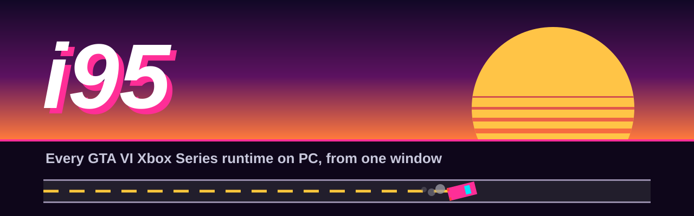

# i95: GTA 6 PC Launcher for every GTA VI Xbox Series runtime (VIctory, Kelvaroq, VItoriaBr and more)

Try them all from one window.

i95 is a Windows launcher for the projects trying to run the Xbox Series version of GTA VI on PC. It doesn't include or download the game, and there are no game files, keys or protection bypasses in it.

**It builds every runtime from source on your PC.** Each runtime's source code is pinned to one commit you can read on GitHub, and i95 compiles it locally with Rust, so you never run an .exe someone else built. That's safer than downloading prebuilt runtime exes, which is how fake "GTA 6 PC" malware spreads.

## What it does

- **One list of runtimes**, ranked like the race tracker, each with its author's own default launch settings.
- **Stays current without an update**: at start it reads the runtime list from [catalog.txt](catalog.txt) here. An update loop here moves each runtime to its author's newest commit every hour, and any commit that changes the author's launch settings is checked by hand before it goes in. Every launcher picks up the list on its next start. No new release is needed. Offline it uses the list it shipped with.
- **Builds and rebuilds** a runtime only when its source changed, and keeps each runtime's shader cache when it does.
- **Prepares shaders** before the game starts, with a loading screen that shows real progress.
- **Checks your PC first**: graphics card features (D3D12, Shader Model 6.6, mesh shaders), RAM and free disk, and names what's missing.
- **Presets** per runtime, such as Series S, 8 GB cards and crash diagnostics, plus any extra setting a runtime reads.
- **In game**: an fps and frame-time overlay, a controls overlay, and the display kept awake.
- **After a run**: explains why it ended by reading the log, writes a short timeline, and can file an issue report.
- **Asks before downloading** a runtime's source or an optional extra. The one thing it fetches without asking is the small runtime list, catalog.txt.

**None of these runtimes is playable yet.** The tracker's bar for playable is 20 fps and 30 minutes without a crash, and nobody has cleared it.

## Standings

Ranks come from vuyp's [GTA VI PC race tracker](https://vuyp.github.io/gta6-pc-race/) ([repo](https://github.com/vuyp/gta6-pc-race)). i95 has 30 runtimes, and the launcher lists them in one list in that order.

"Its author reports" is what each project says about itself, in its own words where we could. "Here" is our own PC: i5-14400F, RTX 4060 8 GB, 16 GB RAM, Windows 11. Most authors test on faster cards, so expect less on yours if it's like ours.

| Rank | Runtime | Based on | Its author reports | Here |
|---:|---|---|---|---|
| 1 | [Vice-Tay](https://github.com/TaynanGT/Vice-Tay) | VIctory | The tracker's leader: a 21.6 fps median in a 30-minute boat test (one README sentence) and 70 minutes played by hand, RTX 4090; at the playable bar on speed and stability but not counted yet | Testing |
| 2 | [KLBF Lab](https://github.com/PastiiJay/klbf-lab) | VIctory, victory-fork | "Player in control" through the prologue, ~5.7 to 7.3 fps, 77 min session, RX 9070 XT | Testing again. Its intro crash was i95 leaving TuxBox DLLs in the game folder (fixed). The intro video flickers |
| 3 | [VI-BR-PORT](https://github.com/edsuuu/VI-BR-PORT) | victory-fork | "A versão para placas de 8 GB": 4 to 7 fps at 1080p, hour-long sessions, RTX 4060 Ti; the opening cutscene at ~18–19 fps on the Series S profile | ❌ The game stops about 20 s in |
| 4 | [VIctory-7900XTX](https://github.com/avatarmanz/VIctory-7900XTX) | VIctory | Aims for "the world at 30 frames a second". 13 to 22 fps in most scenes, longest run 41 min, RX 7900 XTX | ⚠️ Past the intro at ~15 fps, then out of graphics memory |
| 5 | [Kelvaroq](https://github.com/stellarr-studio/kelvaroq) | VIctory, victory-fork | ~10 fps in typical views on an RTX 5080; a tester's 36 min session without a crash; shaders now translated once (heavy frames ~18 s to ~60 ms) | Testing |
| 6 | [VIctory-RDNA](https://github.com/XaviFortes/VIctory-RDNA) | VIctory | 23.1 fps median in gameplay at Series X 4K on an RX 7900 XT; about 40 minutes played by hand | Not run yet |
| 7 | [VItoriaBr](https://github.com/uiliannn/VItoriaBr) | VIctory, victory-fork | Open world at "até 6 fps" on an RTX 5060 Ti | ✅ 3D prison scene at 2 to 3 fps |
| 8 | [AnyXboxX](https://github.com/LooperSalty/AnyXboxX) | VIctory (Neptune) | "~14 fps in the world" on an RTX 4070 SUPER, 14 to 17 fps over the last minute | ✅ 10 min, no crash, ~14 fps (earlier build). Try this one first on NVIDIA |
| 9 | [victory-fork](https://github.com/fxceless/victory-fork) | VIctory | Half-hour sessions at about 7 to 12 fps; shadowed areas still black | ✅ Intro at 30 fps, 3D scene ~1 fps |
| 10 | [Victory-United](https://github.com/Fayberr/Victory-United) | VIctory | VIctory's best open pull requests, now rebuilt on Vice-Tay's code; a 34.7 minute session played by hand ended normally | Not run yet |
| 11 | [CBL VIctory](https://github.com/cocainebunnylaboratories/cblvictoryvi) | VIctory, victory-fork | 3.63 to 6.39 fps by scene at 4K, a 27 min run, RTX 5080 | Not run yet |
| 12 | [VIctory-Belobug-AMD](https://github.com/Belobug/VIctory-Belobug-AMD) | VIctory | The world at 5 to 8 fps on an RX 9070 XT, a 15 min drive | ❌ |
| 13 | [VIctory-NVIDIA](https://github.com/trustno1-coder/VIctory-NVIDIA) | VIctory-7900XTX | 20 to 22 fps indoors on an RTX 5070, at half render scale on the Series S profile; no session length given | Not run yet |
| 14 | CGBJ ([cool_fox](https://github.com/DoubleGhosty/cool_fox), a continuation) | VIctory | 25 fps average in gameplay on an NVIDIA card, relayed by PortWatch and unconfirmed; an outside build reports a 22.4 fps median on the boat, also unverified; zero-copy buffers now on by default; the original repo is no longer on GitHub | Not run yet |
| 15 | [Flamingo](https://github.com/realblastex/flamingo) | victory-fork | Tuned on "an NVIDIA RTX 4070". 9 to 12 fps in the first scene, a 24 min session | ⚠️ Runs at ~20 fps on average, but models are very dark and the screen flashes black and white |
| 16 | [Vertex](https://github.com/proneonn/Vertex) | VIctory | "Not playable yet." About 7 to 10 fps, no crash in 16 of 18 sessions, RTX 5070 | Not run yet |
| 17 | [ruff-lab](https://github.com/LoverCatys/ruff-lab) | KLBF Lab | Built for 8 GB cards and 16 GB RAM. 3.6 fps average, 39 min session, RX 6600 XT | Not run yet |
| 18 | [victory-unified](https://github.com/Itsbatt/victory-unified) | VIctory | "A unified fork" of several. About 58 min without a crash at 2 to 3 fps, RTX 3070 8 GB | Not run yet |
| 20 | [VIniVIdiVIci](https://github.com/KomanderDG88/VIniVIdiVIci) | victory-fork | "About 3 to 5 frames a second" on an RTX 4060 Ti, a 46 min session | Not run yet |
| 21 | [darkworldhm](https://github.com/darkworldhm/victory-fork-darkworldhm) | victory-fork | A snapshot of victory-fork with its own changes. The stream build showed 5 to 24 fps (unconfirmed) | Not run yet |
| 22 | [Vilocity](https://github.com/voidopcode/vilocity) | its own layer | "Not playable yet." About 11 fps on the Series S profile, RTX 5080; runs end about 7 min in | Not run yet |
| 23 | [BRVIctory-ka1qux](https://github.com/ka1qux/BRVIctory-ka1qux) | victory-fork | "Developed and measured on an AMD Radeon card": 3.2 to 3.6 fps, a 25 min session, RX 7800 XT | Not run yet |
| 25 | [ScarlettPort](https://github.com/ZigZagBoi1/ScarlettPort) | victory-fork | About 4 fps in the opening mission, RTX 3060 | ✅ 3D at 2 to 3 fps |
| 27 | [victory-amd](https://github.com/myokex/victory-amd) | victory-fork | First room at 2 to 3 fps, runs of about 8 min, RX 7800 XT | Not run yet |
| 30 | [DexNom RayTime](https://github.com/DexNom/VIctory) | VIctory | Its "most complete tested build": 3.5 to 4 fps indoors, about 1 with ray tracing, RX 7900 XTX | Not run yet |
| 31 | [VIctory](https://github.com/Marvisak/VIctory) | (the original) | The opening mission at about 1 fps on an RX 6700 XT, "not playable" | Not run yet |
| – | [Kitty6](https://github.com/kitty-core/Kitty6) | VIctory-7900XTX | 20.5 fps median in the opening scene (Series S) on an RTX 4070, ~5 min runs; not on the tracker | Not run yet |
| – | [VKarameloVI](https://github.com/badDevelopper/VKarameloVI) | VIctory-NVIDIA | 11 fps, or 21.8 with NVIDIA Smooth Motion (frame doubling), on its author's card; not on the tracker | Not run yet |
| – | [cool-fox-12gb](https://github.com/miaohaixiang1-netizen/cool-fox-12gb) | CGBJ | cool_fox with VIctory-NVIDIA's 8 GB patches; 7.7 fps at half render scale, 2–3 fps native; not on the tracker | Not run yet |
| – | i95-Victory (ours) | Kelvaroq | Our own fork: Kelvaroq plus the 8 GB and skin fixes from VI-BR-PORT, soldsawn and VItoriaBr | Not run yet |

**Not in i95:** ztrx (#15) and victory-perf (#20) are gone from GitHub. omonkey (#21), Doomsday (#23) and suri (#24) are private builds with no public code, so there's nothing to run.

## Screenshots

**The launcher.** Pick a runtime and a preset, then press Play. **Advanced** sets extra options for a run.

**The loader.** Shows what's happening before the game starts.

**On-screen keys and frame rate.**

How each runtime is built, prepared and started is in [DEVELOPERS.md](DEVELOPERS.md#how-each-runtime-is-wired).

## FAQ

- **Does it work on Windows 10?** Not for every runtime. KLBF Lab needs Shader Model 6.6, and Windows 10's built-in DirectX 12 stops at 6.5; KLBF doesn't load Microsoft's newer DirectX 12 (the Agility SDK), so it crashes on Windows 10. Vilocity does load it.
- **Can I play GTA 6 on PC with this?** Not yet. Every runtime here is still being worked on.
- **Is this a download or a crack?** No. There are no game files, keys or protection bypasses.
- **Whose work is this?** Mostly the people who make the runtimes. i95 is the launcher around them. See [CREDITS.md](CREDITS.md).

## Credits

Every runtime and every project i95 borrows from is in [CREDITS.md](CREDITS.md), with its authors, licence and version. Thanks to all of them, and to [vuyp](https://github.com/vuyp) for the [GTA VI PC race tracker](https://vuyp.github.io/gta6-pc-race/) ([repo](https://github.com/vuyp/gta6-pc-race)), where the ranks come from.

## Licence

GPL-3.0-or-later ([LICENSE](LICENSE)). Each runtime keeps its own licence in `vendor/<name>/LICENSE`. The VIctory forks and ScarlettPort are GPL-3.0, and i95's own TuxBox-based code is Apache-2.0. Grand Theft Auto, GTA and Rockstar Games are trademarks of Take-Two Interactive. Xbox is a trademark of Microsoft. i95 isn't affiliated with or endorsed by them.

Keywords: GTA 6 PC, GTA VI PC, GTA 6 launcher, Grand Theft Auto VI Windows, Xbox Series X|S to PC, Scarlett, VIctory, victory-fork, AnyXboxX, Kelvaroq, KLBF Lab, Flamingo, Belobug, VItoriaBr, ScarlettPort.
