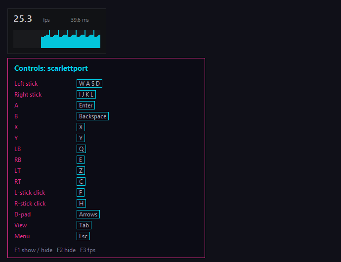

# i95: one launcher for every GTA VI (GTA 6) Xbox Series runtime on PC


Try them all from one window.

i95 is a Windows app that runs the projects trying to bring the Xbox Series version of GTA VI to PC. You pick one, press Play, and i95 builds it, prepares the shaders and starts the game. It uses a copy of the game you dumped from your own console. No game files are included.

**None of these runtimes is playable yet.** The tracker's bar for playable is 20 fps and 30 minutes without a crash, and nobody has cleared it.

## Standings

Ranks come from vuyp's [GTA VI PC race tracker](https://vuyp.github.io/gta6-pc-race/) ([repo](https://github.com/vuyp/gta6-pc-race)). i95 has 22 runtimes, and the launcher lists them in one list in that order.

"Its author reports" is what each project says about itself, in its own words where we could. "Here" is our own PC: i5-14400F, RTX 4060 8 GB, 16 GB RAM, Windows 11. Most authors test on faster cards, so expect less on yours if it's like ours.

| Rank | Runtime | Based on | Its author reports | Here |
|---:|---|---|---|---|
| 1 | [VIctory-7900XTX](https://github.com/avatarmanz/VIctory-7900XTX) | VIctory | Aims for "the world at 30 frames a second". 13 to 22 fps in most scenes, longest run 41 min, RX 7900 XTX | ⚠️ Past the intro at ~15 fps, then out of graphics memory |
| 2 | [AnyXboxX](https://github.com/LooperSalty/AnyXboxX) | VIctory (Neptune) | "~14 fps in the world" on an RTX 4070 SUPER, 14 to 17 fps over the last minute | ✅ 10 min, no crash, ~14 fps (earlier build). Try this one first on NVIDIA |
| 3 | [Kelvaroq](https://github.com/fablinoo/kelvaroq) | VIctory, victory-fork | ~10 fps in typical views on an RTX 5080; a tester's 36 min session without a crash | Testing |
| 4 | [KLBF Lab](https://github.com/PastiiJay/klbf-lab) | VIctory, victory-fork | "Player in control" through the prologue, ~5.7 to 7.3 fps, 77 min session, RX 9070 XT | Testing again. Its intro crash was i95 leaving TuxBox DLLs in the game folder (fixed). The intro video flickers |
| 5 | [Flamingo](https://github.com/realblastex/flamingo) | victory-fork | Tuned on "an NVIDIA RTX 4070". 9 to 12 fps in the first scene, a 24 min session | ⚠️ Runs at ~20 fps on average, but models are very dark and the screen flashes black and white |
| 6 | [victory-fork](https://github.com/fxceless/victory-fork) | VIctory | Half-hour sessions at about 7 to 12 fps; shadowed areas still black | ✅ Intro at 30 fps, 3D scene ~1 fps |
| 7 | [Vice-Tay](https://github.com/TaynanGT/Vice-Tay) | VIctory | 30 min in the world without a crash, 7.0 fps median, RTX 4090 | Testing |
| 8 | [VI-BR-PORT](https://github.com/edsuuu/VI-BR-PORT) | victory-fork | "A versão para placas de 8 GB": 4 to 7 fps at 1080p, hour-long sessions, RTX 4060 Ti | ❌ The game stops about 20 s in |
| 9 | [VIctory-Belobug-AMD](https://github.com/Belobug/VIctory-Belobug-AMD) | VIctory | The world at 5 to 8 fps on an RX 9070 XT, a 15 min drive | ❌ |
| 10 | [VItoriaBr](https://github.com/uiliannn/VItoriaBr) | VIctory, victory-fork | Open world at "até 6 fps" on an RTX 5060 Ti | ✅ 3D prison scene at 2 to 3 fps |
| 11 | [Vertex](https://github.com/proneonn/Vertex) | VIctory | "Not playable yet." About 7 to 10 fps, no crash in 16 of 18 sessions, RTX 5070 | Not run yet |
| 12 | [ruff-lab](https://github.com/LoverCatys/ruff-lab) | KLBF Lab | Built for 8 GB cards and 16 GB RAM. 3.6 fps average, 39 min session, RX 6600 XT | Not run yet |
| 13 | [victory-unified](https://github.com/Itsbatt/victory-unified) | VIctory | "A unified fork" of several. About 58 min without a crash at 2 to 3 fps, RTX 3070 8 GB | Not run yet |
| 14 | [CBL VIctory](https://github.com/cocainebunnylaboratories/cblvictoryvi) | VIctory, victory-fork | 3.63 to 6.39 fps by scene at 4K, a 27 min run, RTX 5080 | Not run yet |
| 16 | [VIniVIdiVIci](https://github.com/KomanderDG88/VIniVIdiVIci) | victory-fork | "About 3 to 5 frames a second" on an RTX 4060 Ti, a 46 min session | Not run yet |
| 17 | [darkworldhm](https://github.com/darkworldhm/victory-fork-darkworldhm) | victory-fork | A snapshot of victory-fork with its own changes. The stream build showed 5 to 24 fps (unconfirmed) | Not run yet |
| 18 | [Vilocity](https://github.com/voidopcode/vilocity) | its own layer | "Not playable yet." About 11 fps on the Series S profile, RTX 5080; runs end about 7 min in | Not run yet |
| 19 | [BRVIctory-ka1qux](https://github.com/ka1qux/BRVIctory-ka1qux) | victory-fork | "Developed and measured on an AMD Radeon card": 3.2 to 3.6 fps, a 25 min session, RX 7800 XT | Not run yet |
| 22 | [victory-amd](https://github.com/myokex/victory-amd) | victory-fork | First room at 2 to 3 fps, runs of about 8 min, RX 7800 XT | Not run yet |
| 25 | [DexNom RayTime](https://github.com/DexNom/VIctory) | VIctory | Its "most complete tested build": 3.5 to 4 fps indoors, about 1 with ray tracing, RX 7900 XTX | Not run yet |
| 26 | [ScarlettPort](https://github.com/ZigZagBoi1/ScarlettPort) | victory-fork | About 4 fps in the opening mission, RTX 3060 | ✅ 3D at 2 to 3 fps |
| 27 | [VIctory](https://github.com/Marvisak/VIctory) | (the original) | The opening mission at about 1 fps on an RX 6700 XT, "not playable" | Not run yet |

**Not in i95:** ztrx (#15) and victory-perf (#20) are gone from GitHub. omonkey (#21), Doomsday (#23) and suri (#24) are private builds with no public code, so there's nothing to run.

## Get started

1. Download the **v0.3.0-alpha** zip from [Releases](../../releases).
2. Unzip it anywhere, for example `C:\Games\i95`.
3. Run `i95.exe`.
4. If it doesn't find your game folder, click **Change** and pick it. Then choose a runtime and press **Play**.

The first start of a runtime takes a while. It builds the runtime and prepares the game's shaders. The loading screen shows the real counts as it goes, like "translating shaders 1,000 / 26,503". Later starts are quicker, because a runtime that hasn't changed isn't built again.

## What you need

- **Your own copy of the game.** The Xbox Series X|S version of GTA VI, dumped from a console you own. It's the folder with `game_scarlett_master.exe` in it, about 210 GB.
- **Windows 10 or 11**, 64-bit, on a processor with AVX2.
- **A graphics card** with DirectX 12 mesh shaders (Shader Model 6.6) and a recent driver.
- **32 GB of RAM** is best.
- **Disk space** for the game, plus up to about 20 GB per runtime.

## Presets

The default launch is each runtime's own, the way its author starts it. Each runtime also has presets you can pick before pressing Play:

- **series_s**: runs as a Series S, which uses less GPU memory. Try it on 8 GB cards.
- **dred**: writes D3D12 crash details to the log. Turn it on when the game crashes and you want to report it.
- **8gb**: VItoriaBr's settings for 8 GB cards, on every runtime that reads them.
- **warp**: draws on the CPU instead of the GPU. It's very slow, but it shows whether a crash comes from your graphics driver.

dred and warp make the launcher use the runtime's diagnostics build, because those switches only exist there. Runtimes whose author ships no diagnostics build (AnyXboxx, Flamingo, KLBF, Unified) don't get them. Some runtimes add their own, like KLBF's `fsr`, Ka1qux's `fsr` and `frame_gen`, or Vertex's `tuned`. **Advanced** takes any other `KEY=VALUE` setting, and **Options list** there shows what that runtime reads.

## Screenshots

**The launcher.** Pick a runtime and a preset, then press Play. **Advanced** sets extra options for a run.


**The loader.** Shows what's happening before the game starts.


**On-screen keys and frame rate.**



How each runtime is built, prepared and started is in [DEVELOPERS.md](DEVELOPERS.md#how-each-runtime-is-wired).

## Watch on your phone (Tailscale)

Run this in a terminal in the i95 folder, or hand it to your AI agent:

```powershell
.\i95.exe --feed-only
```

1. It prints a Tailscale sign-in link. Open it, sign in to your own free Tailscale account and approve the PC. You only do this once.
2. It prints the address of your stream, ending in `ts.net`. First open `http://127.0.0.1:8788` on this PC and set a stream password.
3. Install the Tailscale app on your phone, sign in to the same account, and open that address.
4. Leave the window open and start games with `NEONBRIDGE_FEED=1` set. You can also skip `--feed-only` and just launch with it set, and the stream starts with the game. `NEONBRIDGE_FEED_SCREEN=1` streams your whole left monitor instead of the game window.

## Keys

| Key | Does |
|---|---|
| **F1** | Shows or hides the controls |
| **F2** | Hides the controls |
| **F3** | Shows or hides the frame rate |

Each runtime has its own keyboard and mouse layout. Press F1 in game to see it.

## Where things are

Everything i95 keeps is in `%LOCALAPPDATA%\6ixpack`. Paste that into the Explorer address bar to open it.

| What | Folder |
|---|---|
| Saves | `6ixpack\save` |
| Shaders and other caches | `6ixpack\cache` and `6ixpack\<runtime>\cache` |
| Logs | `6ixpack\logs` |

## Troubleshooting

- **The game crashed or closed.** Every run is logged and i95 tells you where. Send the newest file from `%LOCALAPPDATA%\6ixpack\logs` with your report.
- **A runtime is greyed out.** It needs something that isn't installed. Select it to see what, then click **Install...**.
- **The first start is slow.** That's the shaders being prepared. It only happens the first time.
- **It says no game was found.** Click **Change** and pick the folder with `game_scarlett_master.exe` in it.

## FAQ

- **Can I play GTA 6 on PC with this?** Not yet. Every runtime here is still being worked on.
- **Is this a download or a crack?** No. There are no game files, keys or protection bypasses. You need your own dump.
- **Whose work is this?** Mostly the people who make the runtimes. i95 is the launcher around them. See [CREDITS.md](CREDITS.md).
- **Does it go online?** Only when you say yes, for example to an **Install...** download.

<details>
<summary><b>For developers</b></summary>

Building from source, the command line, runtime settings, patches and environment variables are in [DEVELOPERS.md](DEVELOPERS.md).

</details>

## Credits

Every runtime and every project i95 borrows from is in [CREDITS.md](CREDITS.md), with its authors, licence and version. Thanks to all of them, and to [vuyp](https://github.com/vuyp) for the [GTA VI PC race tracker](https://vuyp.github.io/gta6-pc-race/) ([repo](https://github.com/vuyp/gta6-pc-race)), where the ranks come from.

## Licence

GPL-3.0-or-later ([LICENSE](LICENSE)). Each runtime keeps its own licence in `vendor/<name>/LICENSE`. The VIctory forks and ScarlettPort are GPL-3.0, and i95's own TuxBox-based code is Apache-2.0. Grand Theft Auto, GTA and Rockstar Games are trademarks of Take-Two Interactive. Xbox is a trademark of Microsoft. i95 isn't affiliated with or endorsed by them.

<sub>Keywords: GTA 6 PC, GTA VI PC, GTA 6 launcher, Grand Theft Auto VI Windows, Xbox Series X|S to PC, Scarlett, VIctory, victory-fork, AnyXboxX, Kelvaroq, KLBF Lab, Flamingo, Belobug, VItoriaBr, ScarlettPort.</sub>
