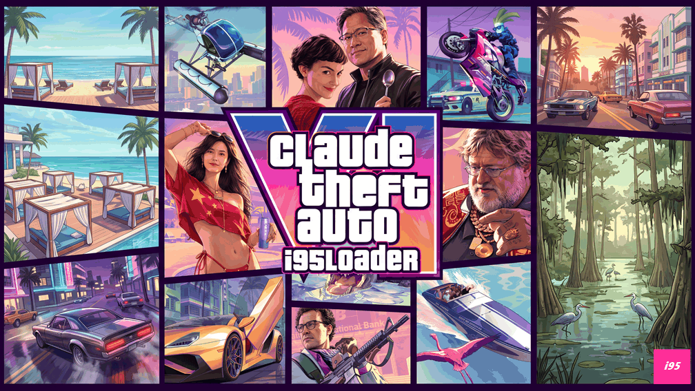
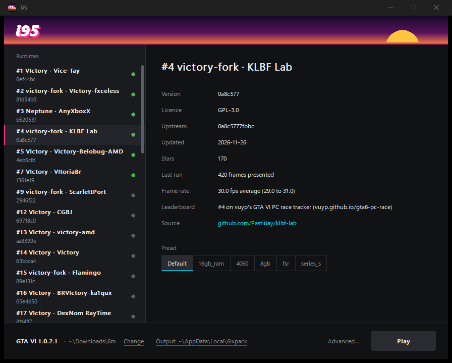

# i95Loader: GTA 6 PC Launcher for every GTA VI Xbox Series runtime (VIctory, Kelvaroq, VItoriaBr and more)

Try them all from one window.

i95 is a Windows launcher for the projects trying to run the Xbox Series version of GTA VI on PC. It doesn't include or download the game, and there are no game files, keys or protection bypasses in it.

**It builds every runtime from source on your PC.** Each runtime's source code is pinned to one commit you can read on GitHub, and i95 compiles it locally with Rust, so you never run an .exe someone else built. That's safer than downloading prebuilt runtime exes, which is how fake "GTA 6 PC" malware spreads.

## Get started

1. Install [Rust](https://rustup.rs) and [Visual Studio Build Tools](https://visualstudio.microsoft.com/visual-cpp-build-tools/) with **Desktop development with C++** (the x64 C++ tools and the Windows SDK). i95 needs them to build each runtime on your PC.
2. Download `i95-<version>.zip` from the [latest release](https://github.com/DesignWithTommy/i95-GTA6-PC-Launcher/releases/latest), unzip it anywhere and run `i95.exe`.
3. Point it at your own copy of the game's Xbox Series folder, pick a runtime and a preset, and press **Play**. The first start of a runtime builds it and prepares its shaders, which can take a while; later starts are quick.

On an 8 GB card, pick a runtime's `8gb` or `series_s` preset: most runtimes default to Series X and run out of graphics memory there.

## What it does

- **One list of runtimes**, ranked like the race tracker, each with its author's own default launch settings.
- **Stays current without an update**: at start it reads the runtime list from [catalog.txt](catalog.txt) here. Each runtime is moved to its author's newest commit several times a day (scripts/bump-upstreams.sh, no bot), and any commit that changes the author's launch settings is read before it goes in. Every launcher picks up the list on its next start. No new release is needed. Offline it uses the list it shipped with.
- **Builds and rebuilds** a runtime only when its source changed, and keeps each runtime's shader cache when it does (a fork that keyed its cache on its own exe, KLBF Lab, is patched to key on its shader translator instead; `NEONBRIDGE_SHADER_KEY_PATCH=0` turns that off).
- **Prepares shaders** before the game starts, with a loading screen that shows real progress. Your own picture at `%LOCALAPPDATA%\6ixpack\splash.bmp` shows on the loading screen.
- **Checks your PC first**: graphics card features (D3D12, Shader Model 6.6, mesh shaders), RAM and free disk, and names what's missing.
- **Presets** per runtime, such as Series S, 8 GB cards, 16 GB laptops, DLSS to 4K, 16 GB of RAM (Vice-Tay's `4060` preset: 38 min at ~10 fps on an RTX 4060 here) and crash diagnostics, plus any extra setting a runtime reads.
- **In game**: one fps panel for every runtime, Vice-Tay's HUD (fps, frame-time graph, GPU and memory, CPU cores; F3 hides it), in place of each runtime's own; a controls overlay; the display kept awake.
- **After a run**: explains why it ended by reading the log, writes a short timeline, and can file an issue report.
- **Asks before downloading** a runtime's source or an optional extra. The one thing it fetches without asking is the small runtime list, catalog.txt.

**None of these runtimes is confirmed playable yet.** The tracker's bar for playable is 20 fps and 30 minutes without a crash. Only Vice-Tay reports clearing it (a 30-minute session at a 21.1 fps median on an RTX 4090), and nobody outside the project has checked it.

## Standings

i95 ranks every runtime itself, with [PortWatch VI](https://portwatch-vi.xyz/)'s scoring formula (how far it gets, then story, picture, fps against 30 and stability). Where PortWatch has assessed a runtime we use its numbers; the rest are scored from each author's own report by `scripts/rank.py`. The launcher lists them in this order. vuyp's [race tracker](https://vuyp.github.io/gta6-pc-race/) ranks fewer of them.

"Its author reports" is what each project says about itself, in its own words where we could. "Here" is our own PC: i5-14400F, RTX 4060 8 GB, 16 GB RAM, Windows 11. Most authors test on faster cards, so expect less on yours if it's like ours.

| Rank | Score | Runtime | Based on | Tuned for | Its author reports | Compiles | Here |
|---:|---:|---|---|---|---|:---:|---|
| 1 | 90 | [VIctory-NVIDIA](https://github.com/trustno1-coder/VIctory-NVIDIA) | VIctory-7900XTX | NVIDIA | CGBJ renderer with DLSS: 26 to 30 fps in the opening rooms and the first boat ride, RTX 5070, generated frames off and not counted (DLSS needs NVIDIA files i95 doesn't fetch; without them it runs Series X at native 1440p, uncapped) | ✅ | Not run yet |
| 2 | 77.4 | [DexNom RayTime](https://github.com/DexNom/VIctory) | VIctory | AMD | 1 fps with ray tracing on, 3.5 to 4 without, RX 7900 XTX | ✅ | Not run yet |
| 3 | 73 | [Vice-Tay](https://github.com/TaynanGT/Vice-Tay) | VIctory | NVIDIA | The tracker's leader and playable by its own report: a 21.1 fps median over a 30-minute session played by hand, Series S profile, RTX 4090 | ✅ | ✅ The `4060` preset: 38 min in 3D at 10.3 fps on average (30 in quiet rooms, under 1 in busy scenes), then out of graphics memory. Rough picture. Plain Series S: 3 to 4 fps (paged to disk); `8gb`: 5 fps; Series X (its default) crashes in the first cutscene on 8 GB |
| 4 | 68.8 | [Kelvaroq](https://github.com/stellarr-studio/kelvaroq) | VIctory, victory-fork | NVIDIA | ~10 fps in typical views (7 to 8 in the heaviest) at 4K on an RTX 5080; a tester's 36 min session without a crash; its unreleased direct memory path needs 22 ms of GPU work an open-world frame and holds 30 fps on loading screens | ✅ | Testing |
| 5 | 68.3 | [Vilocity](https://github.com/voidopcode/vilocity) | cool_fox (was its own layer) | NVIDIA | 33 fps median through the opening and 25 to 29 in the open world, 12 minutes of each unattended without a crash or driver timeout, Series S, RTX 5080; "not playable yet" | ✅ | Not run yet |
| 6 | 68.1 | [VIctory-RDNA](https://github.com/XaviFortes/VIctory-RDNA) | VIctory | AMD | 19.1 to 23.1 fps medians at Series X 4K in one capture under 10 minutes, RX 7900 XT; about 40 minutes by hand on earlier builds | ✅ | Not run yet |
| 7 | 67.5 | [KLBF Lab](https://github.com/PastiiJay/klbf-lab) | VIctory, victory-fork | AMD | 14.0 fps average over 37 minutes of play, player in control through the prologue (77 min on an earlier build), RX 9070 XT | ✅ | Testing again. Its intro crash was i95 leaving TuxBox DLLs in the game folder (fixed). The intro video flickers |
| 8 | 67.5 | [victory-8gb](https://github.com/CuteBooty/victory-8gb) | VIctory | NVIDIA 8 GB | First Chapter I mission played, a 5 h 45 min session without a crash, RTX 3070 8 GB | ✅ | Not run yet |
| 9 | 66.5 | [playablegames-peppa](https://github.com/Peppacodes/playablegames-peppa) | VIctory | NVIDIA | 23.5 fps over 12 minutes in a house interior, RTX 5080 16 GB | ✅ | Not run yet |
| 10 | 65.1 | [RAZDA4A-XEN](https://github.com/crossducking/RAZDA4A-XEN) | VIctory | AMD | For AMD RDNA: 15.2 to 23.4 fps native in the open world, 29 to 31 shown with FSR 3.1 frame generation; a prebuilt exe, no sources; not on the tracker | — | Not run yet |
| 11 | 64.9 | [mavis-9070xt](https://github.com/mavis140/mavis-9070xt) | VIctory-7900XTX | AMD | 18.9 fps median over a 27-minute session, Series X at 1440p, ray tracing off, RX 9070 XT 16 GB | ✅ | Not run yet |
| 12 | 63.7 | [Victory Grimkaaah](https://github.com/Grimkaaah/Victory-Grimkaaah) | VIctory | AMD | AMD only: 24.3 fps average in busy world scenes (ray tracing off), 13.9 with it on, 3-9 min sessions, RX 7900 XTX; on the tracker's watch list | ✅ | Not run yet |
| 13 | 63.3 | [Neptune](https://github.com/Dolberthi/neptune-dolberth-nvidia-8gb) | VIctory | NVIDIA 8 GB | Tuned for 8 GB NVIDIA, 6-core Ryzen, 16 GB RAM; no fps figure yet | ✅ | Not run yet |
| 14 | 63.3 | [ruff-lab](https://github.com/LoverCatys/ruff-lab) | KLBF Lab | AMD 8 GB | Built for 8 GB cards and 16 GB RAM: 6 to 7 fps by scene at 720p upscaled, 30 to 39 min runs without a crash, RX 6600 XT | ✅ | Not run yet |
| 15 | 63.1 | [VIniVIdiVIci](https://github.com/KomanderDG88/VIniVIdiVIci) | victory-fork | NVIDIA | 6.0 fps median in the first room on its defaults, 38 minutes in the world, RTX 4060 Ti | ✅ | Not run yet |
| 16 | 62.9 | [AnyXboxX](https://github.com/LooperSalty/AnyXboxX) | Vice-Tay (was Neptune) | NVIDIA | "About 24 fps median in the world in Full HD", 30 (the game's cap) in lighter scenes, Series X, RTX 4070 SUPER | ✅ | ⚠️ On its new Vice-Tay base: reaches 3D at 0.5 to 3 fps in two 2 to 3 min runs, no crash; RAM full (15.5 of 15.8 GB), so it pages. Its earlier Neptune build ran 10 min at ~14 fps |
| 17 | 62.6 | [VIctory_sm86](https://github.com/whiteh4cker-tr/VIctory_sm86) | VIctory | NVIDIA | 27-30 fps in the opening on an RTX 3090 (1440p, DLSS Quality) | ✅ | Not run yet |
| 18 | 62.5 | [Kitty6](https://github.com/kitty-core/Kitty6) | VIctory-7900XTX | NVIDIA | 20.5 fps median in the opening scene (Series S) on an RTX 4070, ~5 min runs; not on the tracker | ✅ | Not run yet |
| 19 | 62.1 | [BRVIctory-ka1qux](https://github.com/ka1qux/BRVIctory-ka1qux) | victory-fork | AMD | 10.5 fps on Series X with its patches on (no run length on this base; 4 to 4.7 fps over 25 min on the earlier one), RX 7800 XT | ✅ | Not run yet |
| 20 | 62 | [victory-unified](https://github.com/Itsbatt/victory-unified) | VIctory | NVIDIA 8 GB | "A unified fork" tuned for an RTX 3070 8 GB: 2 to 3 fps, about 58 minutes without a crash | ✅ | Not run yet |
| 21 | 61.5 | CGBJ ([cool_fox](https://github.com/DoubleGhosty/cool_fox), a continuation) | VIctory | NVIDIA | 25 fps average in gameplay on an NVIDIA card, relayed by PortWatch and unconfirmed; an outside build reports a 22.4 fps median on the boat, also unverified; zero-copy buffers now on by default; the original repo is no longer on GitHub | ✅ | Not run yet |
| 22 | 61.5 | [Flamingo](https://github.com/realblastex/flamingo) | victory-fork | NVIDIA | 8.6 fps average over a 24-minute session, RTX 4070, unconfirmed | ✅ | ⚠️ Runs at ~20 fps on average, but models are very dark and the screen flashes black and white |
| 23 | 61 | [ApexVI](https://github.com/KevinPratap/ApexVI) | VIctory | NVIDIA 6-8 GB | Tuned for 6-8 GB laptop cards: a controllable character at 6.35 to 7.5 fps, 14-15 min runs without a crash, RTX 4050 6 GB; on the tracker's watch list | ✅ | Not run yet |
| 24 | 60.5 | [SlaktarnVI](https://github.com/Slaktarn700/SlaktarnVI) | VIctory | AMD | Linux/Proton on an RX 9070 XT: 19-25 fps | ✅ | Not run yet |
| 25 | 60.5 | [VI-BR-PORT](https://github.com/edsuuu/VI-BR-PORT) | victory-fork | NVIDIA 8 GB | 24 fps on a scripted prison walk and 21 fps in the opening cutscene, RTX 4060 Ti 8 GB; the author now calls it playable, with known picture problems | ✅ | ❌ The game stops about 20 s in |
| 26 | 60.4 | [VIctory-NVIDIA-RT](https://github.com/Kemerd/VIctory-NVIDIA-RT) | VIctory-NVIDIA | NVIDIA | A faster VIctory-NVIDIA with ultrawide, Reflex, HDR10, DLSS and frame generation: 21.9 fps median, 31.9 best in the open world, RTX 5090 at 1440p with DLSS Quality, no frame generation; not on the tracker | ✅ | Not run yet |
| 27 | 60.1 | [PiloteBox](https://github.com/PiloteCode/PiloteBox) | VIctory | NVIDIA | For NVIDIA: 20.5 to 21.5 fps (46.6 to 48.8 ms a frame) in the prologue's first playable scene on 0.13.1, Series X, RTX 5090; Series S at 60.6 ms a frame; on the tracker's watch list | ✅ | Not run yet |
| 28 | 60 | [victory-sley-fork](https://github.com/Spaghetih/victory-sley-fork) | VIctory | NVIDIA | 20.6 fps median at about 6,000 draws, 11-15 in dense night scenes; FSR 3.1 on NVIDIA | ✅ | Not run yet |
| 29 | 59.8 | [victory-fork](https://github.com/fxceless/victory-fork) | VIctory | NVIDIA | Its ray-tracing builder is now its default: 0.2 to 3 fps with ray-traced shadows and light, 5 to 9 min runs ending in a crash in the game's script code, RTX 4070; without it about 11 fps at the first boat mission | ✅ | ✅ Intro at 30 fps, 3D scene ~1 fps |
| 30 | 59.6 | [VItoriaBr](https://github.com/uiliannn/VItoriaBr) | VIctory, victory-fork | NVIDIA 8 GB | 4 to 6 fps on its current settings | ✅ | ✅ 3D prison scene at 2 to 3 fps |
| 31 | 59.3 | [foxhound](https://github.com/readmet3xt-lab/foxhound) | VIctory | NVIDIA | DLSS and frame generation: 30 fps cap on a 4070 SUPER, 16-21 in heavier scenes | ✅ | Not run yet |
| 32 | 59.3 | [victory-scarlett-3070](https://github.com/Yaekai/victory-scarlett-3070) | Scarlett fork | NVIDIA 8 GB | Tuned for 8 GB NVIDIA (RTX 3070): 16-21 fps in heavy scenes | ✅ | Not run yet |
| 33 | 59.1 | [VIscosity](https://github.com/FrancescoGelosoEterea/VIscosity) | victory-fork | NVIDIA | 17.9 fps median on an RTX 5070 Ti (Series S) | ✅ | Not run yet |
| 34 | 59 | [Victory-United](https://github.com/Fayberr/Victory-United) | VIctory | Any | VIctory's best open pull requests on Vice-Tay's code: 8 to 12 fps in the open world with scripted movement, three 7-minute runs, Series S; 'not playable yet' | ✅ | Not run yet |
| 35 | 58.5 | [Victory-naixue2233](https://github.com/naixue2233/Victory-naixue2233) | victory-fork | NVIDIA | About 11 fps at the first boat mission on an RTX 4070 (with its measured switches) | ✅ | Not run yet |
| 36 | 57.6 | [CBL VIctory](https://github.com/cocainebunnylaboratories/cblvictoryvi) | Vice-Tay | NVIDIA | Now on Vice-Tay's renderer: about 12-15 fps at Series X 1440p, RTX 5080 | ✅ | Not run yet |
| 37 | 56.8 | [VKarameloVI](https://github.com/badDevelopper/VKarameloVI) | VIctory-NVIDIA | NVIDIA | 11 fps, or 21.8 with NVIDIA Smooth Motion (frame doubling), on its author's card; not on the tracker | ✅ | Not run yet |
| 38 | 56.8 | [VIctory-NVIDIA (pepezin-ai)](https://github.com/pepezin-ai/VIctory-NVIDIA) | VIctory-NVIDIA | NVIDIA | DLSS frame generation fixed: 11 fps rendered, 44 shown at 4x, RTX 5070 12 GB in the prologue; not on the tracker | ✅ | Not run yet |
| 39 | 56.5 | [victory-amd](https://github.com/myokex/victory-amd) | victory-fork | AMD | 2 to 3 fps in the world over 8-minute runs, RTX 4070 | ✅ | Not run yet |
| 40 | 56.5 | [CCS03](https://github.com/JozefDeTremmerie/CCS03) | victory-fork | NVIDIA 8 GB | Lucia's prologue played to chapter 1; 3 to 7.8 fps in the prison and on the water, RTX 4060 Laptop 8 GB | ✅ | Not run yet |
| 41 | 56.5 | [Dark-Victory](https://github.com/darksidexc/Dark-Victory-RX6600-I714700KF-VI) | VIctory | AMD 8 GB | About 10 fps on an RX 6600 | ✅ | Not run yet |
| 42 | 56.5 | [Leonida](https://github.com/ProjectLeonidaL/leonida) | own (static recompilation) | Any | About 10 fps in the first rooms with its newer switches; not a VIctory fork | ✅ | Not run yet |
| 43 | 56.5 | [victory-perf](https://github.com/vitutu1/victory-perf) | victory-fork | NVIDIA | 14 fps in the prison corridor, 9 to 11 in interiors, 4.5 to 6.5 in heavy scenes, Series S at half render scale, RTX 4070 SUPER; lighting stand-ins for dark interiors | ✅ | Not run yet |
| 44 | 56.1 | [victory-nvidia-8gb](https://github.com/soldsawn/victory-nvidia-8gb) | VIctory | NVIDIA 8 GB | Tuned for 8 GB NVIDIA (Wave32): 8 to 10 fps on an RTX 4060 Laptop 8 GB at 1080p; not on the tracker | ✅ | Not run yet |
| 45 | 55.7 | [cool-fox-12gb](https://github.com/miaohaixiang1-netizen/cool-fox-12gb) | CGBJ | NVIDIA 8-12 GB | cool_fox with VIctory-NVIDIA's 8 GB patches; 7.7 fps at half render scale, 2–3 fps native; not on the tracker | ✅ | Not run yet |
| 46 | 55.6 | [ScarlettPort](https://github.com/ZigZagBoi1/ScarlettPort) | victory-fork | NVIDIA | About 7 to 8 fps in the world with a warm cache on 0.5.2, Series S, RTX 3060 | ✅ | ✅ 3D at 2 to 3 fps |
| 47 | 55.4 | [victory-4gb](https://github.com/Dathinel/victory-4gb) | victory-fork | NVIDIA 4 GB | 6.5 to 7 fps in open-world free play on a 4 GB RTX 3050 Laptop | ✅ | Not run yet |
| 48 | 55 | [LNX-victory](https://github.com/Linox-IDK/LNX-victory) | VIctory | NVIDIA 8 GB | Prison yard at about 4 fps (Series X), 7-8 fps with Series S + FSR, RTX 5060 Ti 8 GB | ✅ | Not run yet |
| 49 | 54.5 | [victory-amd r13](https://github.com/tinygusie2/victory-amd) | victory-fork | AMD | About 3-5 fps in the open world on an RX 9060 XT | ✅ | Not run yet |
| 50 | 54.5 | [M1LK](https://github.com/3cvil/M1LK) | VIctory | NVIDIA 8 GB | Tuned for 8 GB VRAM and 16 GB RAM: playable at about 4 fps on an RTX 4060 Laptop 8 GB | ✅ | Not run yet |
| 51 | 54.1 | [darkworldhm](https://github.com/darkworldhm/victory-fork-darkworldhm) | victory-fork | NVIDIA | A snapshot of victory-fork with its own changes: 2 to 4 fps in the world, RTX 4070 | ✅ | Not run yet |
| 52 | 53.1 | [MiniVI](https://github.com/Androtim/MiniVI) | cool_fox | Any 8 GB | Built for 8 GB VRAM and 16-32 GB RAM, with an F3 FPS/VRAM overlay; 4 GB and AMD modes | ✅ | Not run yet |
| 53 | 50.3 | [VIctory](https://github.com/Marvisak/VIctory) | (the original) | Any | The opening mission at about 1 fps on an RX 6700 XT, "not playable" | ✅ | Not run yet |
| 54 | 30 | [Five Star Recomp](https://github.com/ThatRecompDev/five-star-recomp) | own (C#) | Any | Intro and opening cutscene at 30 fps, world surfaces still black; needs the .NET SDK; early | ✅ | Not run yet |
| 55 | 10 | [GTA6-BootTest](https://github.com/OnlyMoisties/GTA6-BootTest) | own (C) | Any | Boot harness: frame loop and first UI screen; needs Visual Studio 2022 C tools; early | ✅ | Not run yet |
| 56 | 10 | [PercyScarlett](https://github.com/rpatty-dev/PercyScarlett) | VIctory | NVIDIA | Lit opening prison scene on Series S, 2-3 fps on an RTX 2060 SUPER; early, from PortWatch's watch list | ✅ | Not run yet |
| – | – | VIctory-Belobug-AMD (removed) | VIctory | AMD | 5 to 8 fps over a 15-minute drive, RX 7900 XTX | – | ❌ Removed from the loader: the author's GitHub account was deleted, so the source can no longer be downloaded |
| – | – | VIctory-7900XTX (removed) | VIctory | AMD | 13 to 17 fps in a city street at Series X 1440p, RX 7900 XTX | – | ❌ Removed from the loader: the author's GitHub account was deleted, so the source can no longer be downloaded |
| – | – | Vertex (removed) | VIctory | NVIDIA | "Not playable yet." 6.9 fps median in a 25-minute run, RTX 5070 | – | ❌ Removed from the loader: the author deleted or hid the repository, so the source can no longer be downloaded |
| – | – | Scarlett fork (removed) | CGBJ | NVIDIA | cool_fox plus a local fork's work: 16 to 21 fps in hand-played heavy scenes (prison yard, open world), Series X at 1440p, ray tracing off, RTX 4080 SUPER | – | ❌ Removed from the loader: the author deleted or hid the repository, so the source can no longer be downloaded |
| – | – | POLSKAGUROM (removed) | VIctory | NVIDIA | 19.4 fps average on an RTX 5060 Ti 16 GB (Series S) | – | ❌ Removed from the loader: the author deleted or hid the repository, so the source can no longer be downloaded |
| – | – | i95-Victory (ours) | Kelvaroq | NVIDIA 8 GB | Our own fork: Kelvaroq plus the 8 GB and skin fixes from VI-BR-PORT, soldsawn and VItoriaBr | ✅ | Not run yet |

<b>Early projects not in i95 yet</b> (they don't reach the game's world on Windows)

| Project | What it is (PortWatch's summary, unverified) |
|---|---|
| [xbox-emulator](https://github.com/omonkeyz/xbox-emulator) | Rust runtime that runs dumped Xbox Series builds as normal Windows processes, continuing the TomBox project |
| [xcl](https://github.com/xcl-dev/xcl) | Wine-style layer running game code natively |
| [ScarlettX](https://github.com/Freminet/ScarlettX) | Clean-room high-level emulator of the Scarlett OS and GDK runtime |
| [TuxBox](https://github.com/brcly/TuxBox) | Native-first layer for unpacked Xbox Series games, tested mostly on Linux through Proton |
| [OpenScarlett](https://github.com/californiaAlmonds/OpenScarlett) | MIT-licensed C++20 translation layer targeting D3D12 and Vulkan |
| [scarlett-layer](https://github.com/jadeowaowa/scarlett-layer) | Loader plus injected hook DLL that redirects console-only calls to Windows shims, with its own d3d12_xs wrapper and shader lifter |
| [Xbox2Windows](https://github.com/R0Y00/Xbox2Windows) | Static recompilation research turning Xbox Series code and shaders into Windows C++ and DXIL, with over 50 contributors |
| [keylime](https://github.com/ethan00013/keylime) | A C++20 runtime written from scratch, with Vulkan graphics and its own RDNA2-to-SPIR-V translator |
| [xvalkyrie](https://github.com/sammwyy/xvalkyrie) | Wine-style C++ layer for Xbox One and Series titles with native code and RDNA2-to-HLSL shaders |
| [GTAVI-Recomp](https://github.com/JamesCicada/GTAVI-Recomp) | Targets the PS5 build through AnyPS5 and will not work from leaked files, so game research is blocked |
| [anyxboxseries](https://github.com/edupode/anyxboxseries) | GTA VI-only translation layer with a PE mapper borrowed from Xbox2Windows, an early scalar shader lifter and a sample game that tests presentation and input |
| [SCARAB](https://github.com/p-portela/SCARAB) | Found that the console d3d12_xs uses the same 28 interface IDs as PC D3D12, so standard calls can be forwarded and only the console extensions need building |
| [AnyBox](https://github.com/Dark3581/AnyBox) | Relinks GDK executables against reimplemented system libraries, AnyPS5-style |
| [GrandTheftXbox](https://github.com/zohaiblazuli/GrandTheftXbox) | Wine-style layer planned for Series and One titles |
| [NativeX-Runtime](https://github.com/ProhorovIlja/NativeX-Runtime) | Clean-room test programs for how Game Core software meets Windows, covering loading, memory, presentation and input, plus a radar that watches other projects |
| [DedSec](https://github.com/Hylanderry/DedSec) | Portuguese-language GTA VI port targeting DirectX 12 with an RDNA2-to-HLSL translator |
| [Xbgtasix](https://github.com/ljm-233/Xbgtasix) | Chinese-language layer that places stand-in xgameruntime, xmem and d3d12_xs DLLs next to an executable, plus sourced research notes on the archive, shader and texture formats |
| [SeriesX-Emulator](https://github.com/anrq0/SeriesX-Emulator) | C++ emulator that interprets x86-64 code instead of running it natively, with a launcher and seven XGameRuntime functions |
| [ScarlettCompat](https://github.com/SSTGxf/ScarlettCompat) | C++ layer with its own PE loader and Xbox function registry |
| [xlaunch-vi](https://github.com/JPTuba9/xlaunch-vi) | Multi-contributor C++ layer with a PE loader, a D3D12 backend and an RDNA2 shader translator that matches AMD-compiled test shaders bit for bit |
| [OpenScarlett](https://github.com/OpenCommunityEdition/OpenScarlett) | AGPL C++ layer, separate from the other OpenScarlett, that swaps console DLLs for PC Direct3D 12 ones and translates console GPU code |
| [port-of-the-americas](https://github.com/Steinkoloss/port-of-the-americas) | Linux layer that runs GTA VI's own exe under Proton with replacement console DLLs on a patched vkd3d-proton |
| [G6Recomp](https://github.com/Kajcsi/G6Recomp) | Carefully tested C++ loader and console-runtime rewrite for GTA VI, with its own code throughout |
| [palmetto](https://github.com/luizwidmer/palmetto) | Open continuation of Leonida after its repo went private |

**Not in i95:** ztrx (#6) and the original CGBJ (#12, run here through DoubleGhosty's cool_fox) are gone from GitHub. omonkey (#10), suri (#11) and Doomsday (#20) are private builds with no public code. VIctory-macOS-halfwave50 is macOS only (2.9-4.5 fps on a MacBook Pro).

## Screenshots

**The launcher.** Pick a runtime and a preset, then press Play. **Advanced** sets extra options for a run.

**The loader.** Shows what's happening before the game starts.

**On-screen keys and frame rate.**

How each runtime is built, prepared and started is in [DEVELOPERS.md](DEVELOPERS.md#how-each-runtime-is-wired).

## FAQ

- **Does it work on Windows 10?** Not for every runtime. KLBF Lab needs Shader Model 6.6, and Windows 10's built-in DirectX 12 stops at 6.5; KLBF doesn't load Microsoft's newer DirectX 12 (the Agility SDK), so it crashes on Windows 10. Vilocity does load it.
- **Can I play GTA 6 on PC with this?** Not yet. Every runtime here is still being worked on.
- **Is this a download or a crack?** No. There are no game files, keys or protection bypasses.
- **Whose work is this?** Mostly the people who make the runtimes. i95 is the launcher around them. See [CREDITS.md](CREDITS.md).

## Credits

Every runtime and every project i95 borrows from is in [CREDITS.md](CREDITS.md), with its authors, licence and version. Thanks to all of them, and to [vuyp](https://github.com/vuyp) for the [GTA VI PC race tracker](https://vuyp.github.io/gta6-pc-race/) ([repo](https://github.com/vuyp/gta6-pc-race)), where the ranks come from.

## Licence

GPL-3.0-or-later ([LICENSE](LICENSE)). Each runtime keeps its own licence in `vendor/<name>/LICENSE`. The VIctory forks and ScarlettPort are GPL-3.0, and i95's own TuxBox-based code is Apache-2.0. Grand Theft Auto, GTA and Rockstar Games are trademarks of Take-Two Interactive. Xbox is a trademark of Microsoft. i95 isn't affiliated with or endorsed by them.

Keywords: GTA 6 PC, GTA VI PC, GTA 6 launcher, Grand Theft Auto VI Windows, Xbox Series X|S to PC, Scarlett, VIctory, victory-fork, AnyXboxX, Kelvaroq, KLBF Lab, Flamingo, Belobug, VItoriaBr, ScarlettPort, Vilocity, cool_fox, victory-perf.
