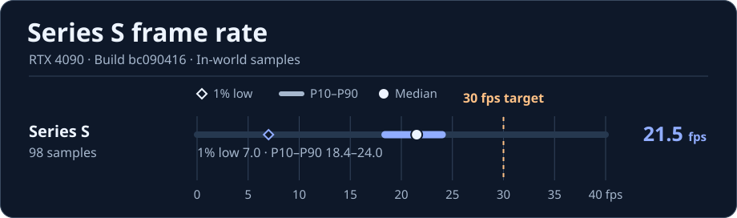
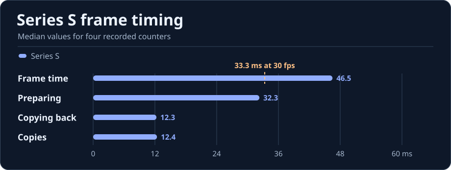
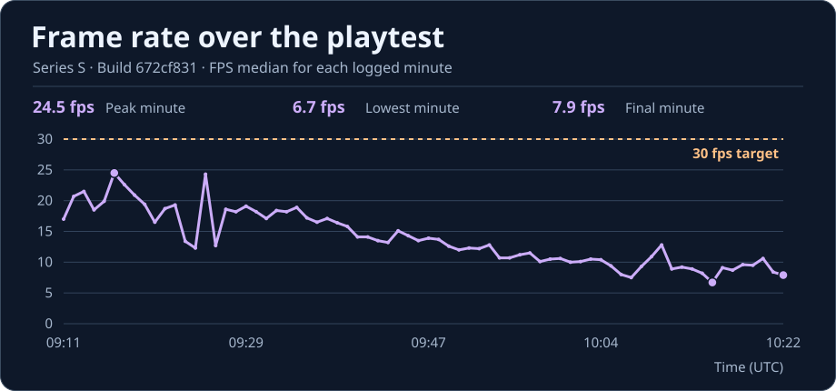

# Vice-Tay

Vice-Tay runs an Xbox Series title natively on Windows, from files you supply,
through [VIctory](https://github.com/Marvisak/VIctory), a compatibility layer:
it loads the console executable, answers its system calls and translates its
GPU work to Direct3D 12. This tree is tuned and fixed on one PC, an RTX 4090
with a Ryzen 9 9950X3D and 48 GB of RAM, toward one goal: the open world at
30 frames a second, with the picture right, fully playable.

**No game files, code or assets are in this repository.** You need your own
copy of the game. Vice-Tay is not affiliated with or endorsed by the game's
developer or publisher.

> [!TIP]
> **[View the gameplay screenshots](https://github.com/TaynanGT/Vice-Tay-Screenshots#readme)**
>
> Ten in-game captures from the Series S playtest.

## At a glance

- **It plays.** A 70-minute session on the Series S profile went from the prison
  through a playable flashback, a boat, a camp, a fist fight and two shoot-outs,
  with menus, the map, checkpoints, deaths and retries, and never crashed or hung.
- **It is not fast enough yet.** The world runs at 14 fps on the Series X profile
  in a fresh session. In the 30-minute Series S boat test, median frame rate rose
  from 21.6 to **22.7 fps**. [Series S playtest](https://github.com/TaynanGT/Vice-Tay/pull/37).
- **It slows down the longer it runs.** In that 70-minute session the game's memory
  grew from 33 GB to 52 GB, past the 43 GB of RAM Windows sees, and the frame rate
  fell from about 20 to under 10. This is the next thing being worked on.

## Test PC

| Component | Configuration |
| --- | --- |
| CPU | AMD Ryzen 9 9950X3D, 16 cores and 32 threads |
| Motherboard | MSI MAG X870 TOMAHAWK WIFI (MS-7E51), revision 1.0 |
| BIOS | MSI 1.A93 |
| GPU | NVIDIA GeForce RTX 4090, 24 GB GDDR6X |
| NVIDIA driver | 621.40 |
| Integrated graphics | AMD Radeon Graphics |
| RAM | 48 GiB DDR5 (2 × 24 GiB), configured at 8,000 MT/s; 43.4 GiB visible to Windows |
| Page file | 128 GiB |
| System SSD | Samsung 990 PRO 4 TB NVMe |
| Additional SSDs | Samsung 990 PRO 2 TB NVMe and Samsung 970 PRO 1 TB NVMe |
| Monitor | Samsung Odyssey OLED G8 (G81SF), 3840 × 2160, 240 Hz |
| OS | Windows 11 Pro 26H2 x64, build 26300.10075 |

## Measurements

<!-- measurements:start -->
### Measured sessions (build 672cf831)

On the test PC above, with `scripts\play.ps1` and its RTX 4090 settings, in
full screen, each session walking, running, turning the camera and taking
captures every minute. Nothing compiled meanwhile; the screen was recorded
to video on the card's encoder throughout.

| Profile | In the world | To the start screen / to the world | fps: median (p10-p90; 1% low) | ms per frame (median) | Game memory, median / max | Card: memory max, load, power, temperature |
|---|---|---|---|---|---|---|
| Series X | 10 min, ended by the runner | 103 s / 161 s | **14.3** (13.6-14.7; 1% low 3.5) | 69.7: 35.0 GPU, 24.3 preparing, 20.0 copying back | 29.3 / 30.6 GB | 13.6 GB, 90.0%, 152.9 W, 57.0 C |
| Series S | 10 min, ended by the runner | 88 s / 127 s | **20.8** (19.2-21.8; 1% low 8.7) | 48.1: 0.2 GPU, 36.9 preparing, 15.8 copying back | 24.2 / 26.0 GB | 12.0 GB, 81.0%, 129.9 W, 48.0 C |
| Series X, `-Safe` | 10 min, ended by the runner | 87 s / 125 s | **15.4** (13.5-17.8; 1% low 3.3) | 64.7: 5.2 GPU, 37.3 preparing, 14.4 copying back | 33.4 / 34.9 GB | 17.6 GB, 97.0%, 154.4 W, 50.8 C |
| Series X, `-RayTracing` | 10 min, ended by the runner | 88 s / 133 s | **8.9** (6.8-11.4; 1% low 4.8) | 112.3: 63.0 GPU, 35.9 preparing, 14.9 copying back | 36.1 / 37.3 GB | 16.4 GB, 84.5%, 137.2 W, 50.4 C |
| Series S, 70 minutes played through the prison | 70 min, ended by the runner | 88 s / 126 s | **12.9** (8.3-20.1; 1% low 5.0) | 77.2: 0.0 GPU, 45.5 preparing, 16.1 copying back | 39.4 / 52.3 GB | 18.4 GB, 49.5%, 110.2 W, 50.1 C |

Every number is from the game's own once-a-second frame lines in the world
(over 1,000 draws a frame) and samples every 20 s; the full tables, with each
part of a frame, are in [docs/measurements.md](docs/measurements.md).
<!-- measurements:end -->

The [play log](docs/play-log.md) records the 70-minute session in detail.

### Benchmark charts

The charts cover the short benchmarks and the 70-minute Series S playtest on
an RTX 4090. [Open the interactive benchmark dashboard](https://taynangt.github.io/Vice-Tay/).





The chart below tracks the long Series S session minute by minute.
[Explore the recorded minutes](https://taynangt.github.io/Vice-Tay/#session).



<!-- Refresh the charts with node scripts/generate-benchmark-charts.mjs after editing the source tables. -->

## Known problems

- **Frame rate.** Below 30 fps in the world. Most of a frame goes to preparing the
  GPU's work on the CPU and copying data back, not to the GPU itself.
- **Memory grows without limit.** About 0.4-0.5 GB a minute in new areas; past
  physical RAM, frame preparation slows to a crawl.
- **Picture.** Skin, hair and some walls show flat bands of colour; some objects
  (tanks, tarps, plants, a skylight) glow in flat purple, pink or blue; some faces
  show scrambled colour patches and some eyes are lit white; clouds and reflections
  break into square blocks; a few shapes render as flat black.
- **Ray tracing.** The ray-traced structures are not built by default (`-RayTracing`
  turns the builder on), so a few hundred dispatches a frame are skipped and some
  light is missing.
- **Loading.** The first run of a new build translates every shader while it plays;
  translate them ahead (below).
- **Measuring.** On the Series S profile the log's GPU-time counter reads near zero;
  it is left out of conclusions until it is clear what it measures there.

## Getting started

You need Windows 10 or 11 x64, a CPU with AVX2, a Direct3D 12 GPU with shader
model 6.6 and mesh shaders, Rust (the toolchain is pinned in the repository),
the MSVC build tools with a Windows SDK, and your own dump of the title.

```powershell
git clone https://github.com/TaynanGT/Vice-Tay
cd Vice-Tay
copy victory.example.toml victory.toml      # then set your paths, outside this folder
cargo build --locked --profile diag -p victory --features diagnostics
```

Before the first run, translate the shaders and warm the pipelines (each can be
stopped and resumed):

```powershell
target\diag\victory.exe shaders <the shader archives>   # every shader, takes minutes
target\diag\victory.exe warm --used                     # pipelines earlier runs drew with
```

Then play:

```powershell
scripts\play.ps1 -Exe <path of your copy's executable>
```

`Play-VIctory.cmd -Exe <path>` does the same from a double-click or a Command Prompt.

| Option | What it does |
|---|---|
| (none) | Full screen, Series X profile, settings picked for your graphics card |
| **F11** or **Alt+Enter** | Switch between full screen and a window while it runs |
| `-Windowed` | Start in a window |
| `-Console series-s` | Run as a Series S: a smaller picture, lighter on the card, faster |
| `-Machine 4090` / `7900xtx` | Force the settings for NVIDIA (measured on the RTX 4090) or AMD |
| `-Safe` | Leave out the changes still on trial; try it first when something goes wrong |
| `-RayTracing` | Turn the title's ray-traced indirect light on |
| `-Build release` | Run `target\release\victory.exe` (`cargo build --release --locked -p victory`) |

Every `VICTORY_...` switch is described in a comment where the code reads it.
More commands and debugging switches:
[docs/README-fxceless.md](docs/README-fxceless.md) and [docs/findings.md](docs/findings.md).

## How this tree is built

Vice-Tay is published as a repository of its own, not as a GitHub fork, with the
whole history of the trees it comes from. It started from codec-d/cool_fox (now
taken down), which is [avatarmanz/VIctory-7900XTX](https://github.com/avatarmanz/VIctory-7900XTX)
with work for NVIDIA cards on top. New work from avatarmanz is merged as it lands,
and our own fixes come in through pull requests, each tested before it is merged.
What each change does: [docs/this-fork.md](docs/this-fork.md). How the layer
works: [docs/architecture.md](docs/architecture.md).

## Credits

This is other people's work with more on top. The history is kept, and commits
taken from elsewhere name the original commit and its author. Everyone with a
commit here is listed in [docs/credits.md](docs/credits.md).

- **[VIctory](https://github.com/Marvisak/VIctory)** by Marvisak and its
  contributors: the loader, the runtime services, the Direct3D 12 back end and
  the shader recompiler.
- **[fxceless/victory-fork](https://github.com/fxceless/victory-fork)** and the
  people whose pull requests it carries.
- **[avatarmanz/VIctory-7900XTX](https://github.com/avatarmanz/VIctory-7900XTX)**:
  list calls recorded on the title's threads and translated by workers,
  submissions prepared on threads of their own, cheaper write guards, textures on
  a copy queue, frame record and replay.
- **codec-d/cool_fox** (taken down by its author): two-plane composition, fallback
  heaps, table plans, the residency guard, fence wakes on `WaitOnAddress`, wave32
  lowering for NVIDIA, movie-plane uploads and XMA audio fixes.
- **[DexNom/VIctory](https://github.com/DexNom/VIctory)**: ray tracing fixes,
  cube gradients, sparse textures.
- **[Belobug/VIctory-Belobug-AMD](https://github.com/Belobug/VIctory-Belobug-AMD)**:
  the ambient light idea, pipeline workers, and work by romainhedouin.
- **[FQY55kai/ZJOU-VICTORY](https://github.com/FQY55kai/ZJOU-VICTORY)**.
- **[myokex/victory-amd](https://github.com/myokex/victory-amd)**: the guard over
  every view of a page (with Spexivus, joroyt and tightfall), and Joshua Odom's
  reads into title memory.
- **Geckomacabre** and **cxy0072019-sketch**: the texture read-back.
- **[XCL](https://github.com/ivall/xcl)** (GPL-2.0-only) was read for how the same
  title behaves under another layer; no code of it is here.

## License

GPL-3.0-or-later, as VIctory. See [LICENSE](LICENSE); the one file it does not
cover is named in [docs/asset-policy.md](docs/asset-policy.md).
